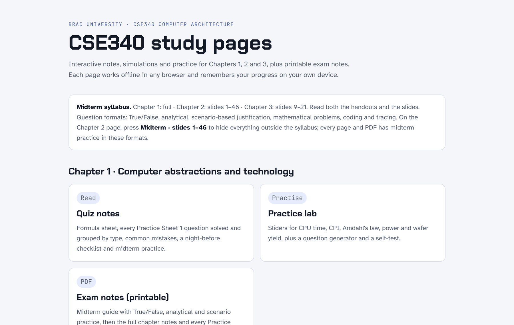
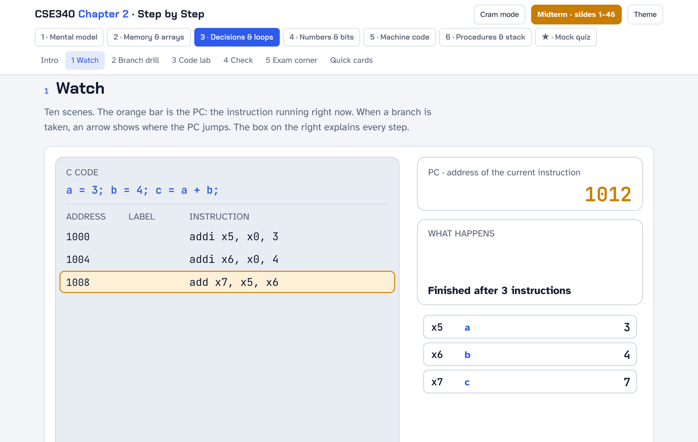
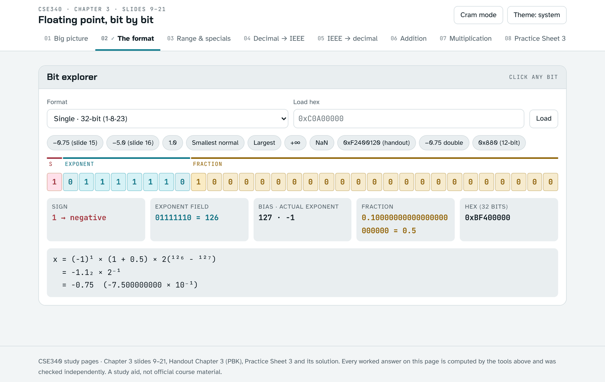
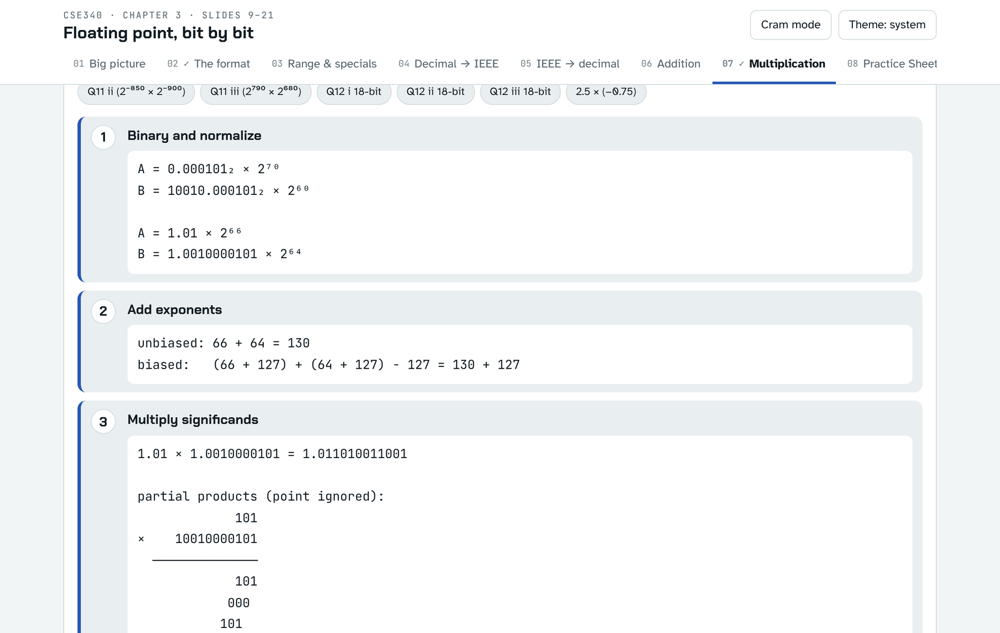

# CSE340 · Computer Architecture, visualized

**Interactive study pages and printable exam notes for BRAC University's CSE340, built so you can *see* what a CPU does instead of memorizing it.**

Click bits and watch a floating-point number change. Type RISC-V code and run it against tests. Step through a loop and watch the PC jump. Every Practice Sheet question for Chapters 1–3 is solved, and every page has a self-test.

---

## Midterm (Fall 2026)

| Chapter | Syllabus | Start with |
|---|---|---|
| 1 · Computer abstractions and technology | **Full chapter** | [Quiz notes](ch1-quiz-notes.html) → [Practice lab](ch1-practice-lab.html) |
| 2 · Instructions: language of the computer | **Slides 1–46** | [Step by step](ch2-step-by-step.html), with **Midterm · slides 1–46** switched on |
| 3 · Arithmetic for computers | **Slides 9–21** (floating point) | [Floating point, bit by bit](ch3-floating-point.html) |

Read both the handouts and the lecture slides. The question formats are **True/False, analytical, scenario-based justification, mathematical problems, coding and tracing**, and every chapter here has practice in each format that applies to it.

---

## What's inside

### Interactive pages

| Page | What you can do |
|---|---|
| [`index.html`](index.html) | Start page linking everything below |
| [`ch1-quiz-notes.html`](ch1-quiz-notes.html) | Formula sheet, every Practice Sheet 1 question solved and grouped by type, common mistakes, a night-before list and midterm practice |
| [`ch1-practice-lab.html`](ch1-practice-lab.html) | Sliders for CPU time, CPI, Amdahl's law, power and wafer yield; a question generator and a self-test |
| [`ch2-step-by-step.html`](ch2-step-by-step.html) | Chapter 2 in 7 levels: animated CPU scenes, a code lab that runs your RISC-V, machine-code encoding, procedures and the stack, solved past questions, a timed mock and a **midterm mode** |
| [`ch2-practice-lab.html`](ch2-practice-lab.html) | Instruction encoder/decoder, a step-by-step RISC-V simulator, Practice Sheet 2 analysis and a question generator |
| [`ch3-floating-point.html`](ch3-floating-point.html) | IEEE 754 bit explorer, step-by-step encoder and decoder, FP addition and multiplication steppers, every Practice Sheet 3 question solved, midterm practice and a self-test |

### Printable exam notes (PDF)

| File | Pages | Starts with |
|---|---|---|
| [`pdf/CSE340_Chapter1_Exam_Notes.pdf`](pdf/CSE340_Chapter1_Exam_Notes.pdf) | 25 | 2-page midterm guide: True/False, analytical and scenario practice with answers |
| [`pdf/CSE340_Chapter2_Exam_Notes.pdf`](pdf/CSE340_Chapter2_Exam_Notes.pdf) | 33 | 3-page midterm guide: which pages to skip past slide 46, the branch-immediate rule, and practice in all six formats |
| [`pdf/CSE340_Chapter3_Exam_Notes.pdf`](pdf/CSE340_Chapter3_Exam_Notes.pdf) | 28 | 2-page midterm guide, then IEEE 754 worked step by step and all Practice Sheet 3 answers |

---

## How to use it

- **Easiest:** click **Code → Download ZIP**, unzip, and open `CSE340/index.html` in any browser. Everything works offline.
- **In the browser:** if GitHub Pages is turned on for this repo, open `https://raftan10.github.io/bracu-cse-visualized-resources_by_RAF/CSE340/`.
- **PDFs** open right here on GitHub. Click one in the table above.

Your quiz scores, solved challenges and saved code are kept in your own browser only. Nothing is uploaded anywhere.

**Suggested order for the midterm:** Chapter 1 quiz notes → Chapter 2 levels 1–6 in midterm mode → the Chapter 2 mock quiz and midterm guide → Chapter 3 page from Big picture to Practice Sheet 3 → each PDF's midterm guide the night before.

---

## Good to know

- **Built from the course itself:** the CSE340 slides, the PBK handouts, Practice Sheets 1–3 and their solutions, and the Loop Examples worksheet. Where a slide or a faculty answer has a typo, the page points it out and explains the fix (for example, slide 11's double-precision bias is 1023, not "1203").
- **Course conventions are followed.** In this course a branch's immediate is the byte offset ÷ 2, and the practice sheet uses branch opcode `1100111` instead of the official `1100011`. The pages accept both and say which is which.
- **Every worked answer was checked**, by running it in code or in the pages' own RISC-V simulator.
- **Ask your faculty when in doubt.** These are study aids, not official course material.

---

Made by RAF for juniors taking CSE340 at BRAC University. Free to use and share; if it helped you, pass it on.
