# CSE370 · Database Systems, visualized

**Interactive study pages and printable exam notes for BRAC University's CSE370, built so you can *see* how a database design works instead of memorizing rules.**

Flip a relationship from 1:N to M:N and watch the instance lines change. Insert a bad row and see exactly which constraint it breaks. Step a table through 1NF → 2NF → 3NF. Write SQL against a mock lab paper with a 75-minute timer. Every page has a short demo video below, so you know what to click before you open it.

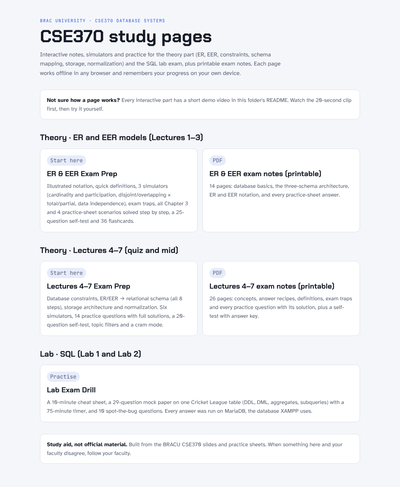

---

## What's inside

### Interactive pages

| Page | Covers | What you can do |
|---|---|---|
| [`index.html`](index.html) | Everything | Start page linking every page and PDF below |
| [`er-eer-exam-prep.html`](er-eer-exam-prep.html) | Lectures 1–3: database basics, ER model, EER model | 8 tabs: big picture, illustrated notation, quick definitions, **3 simulators**, exam traps, memory hooks, **all 12 Chapter 3 & 4 practice-sheet scenarios** revealed step by step, a 25-question self-test and 36 flashcards |
| [`lectures-4-7-exam-prep.html`](lectures-4-7-exam-prep.html) | Lectures 4–7: constraints, ER/EER → relational schema, storage architecture, normalization | **6 simulators**, collapsible concept notes with answer recipes, 14 practice questions with full solutions, a 20-question self-test that lets you retry only your mistakes, topic filters and a cram mode |
| [`lab-exam-drill.html`](lab-exam-drill.html) | Lab 1 and Lab 2: DDL, DML, aggregates, GROUP BY / HAVING, subqueries | A 10-minute cheat sheet, a **29-question mock paper** on one Cricket League table with a 75-minute timer and score counter, and **10 spot-the-bug** questions. Every answer and output was run on MariaDB (the database XAMPP uses) |

### Printable exam notes (PDF)

| File | Pages | What's in it |
|---|---|---|
| [`pdf/CSE370_ER_EER_Notes.pdf`](pdf/CSE370_ER_EER_Notes.pdf) | 14 | Database basics, three-schema architecture and data independence, ER and EER notation, and every practice-sheet answer |
| [`pdf/CSE370_Lectures_4-7_Notes.pdf`](pdf/CSE370_Lectures_4-7_Notes.pdf) | 26 | Lectures 4–7 concepts, answer recipes, definitions, exam traps, every practice question with its solution, and a 20-question self-test with answer key. Works without a device |

---

## Demo videos: how to use each interactive part

Each clip is 15–30 seconds. The red ring shows where to click, and the caption at the bottom says what's happening. The GIFs play right here; click **▶ MP4** under any clip for the sharper full-quality version.

### ER & EER Exam Prep · [`er-eer-exam-prep.html`](er-eer-exam-prep.html)

**1. Cardinality ratio + participation simulator** (Simulators tab, Sim 1)
Pick 1:1, 1:N, N:1 or M:N and switch each side between partial and total. The Chen diagram, the (min,max) version, a plain-English reading and a set of example instances all update together. *Watch for:* participation only decides whether a dot may sit alone; the ratio decides how many lines can meet at one dot.

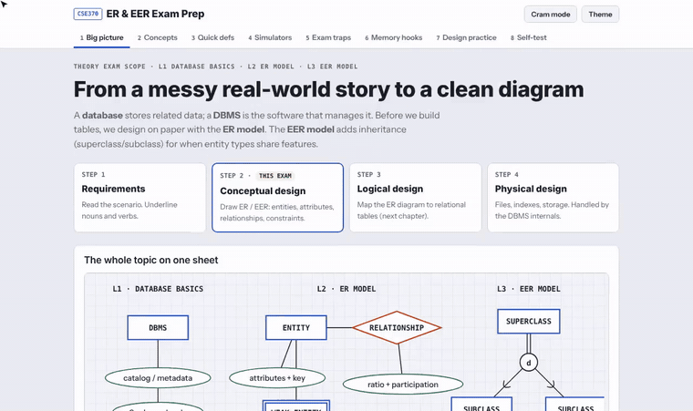
[▶ MP4 (23 s)](media/er-cardinality-sim.mp4)

**2. Disjoint/overlapping × total/partial checker** (Simulators tab, Sim 2)
Tick which subclasses (Secretary, Engineer, Technician) each employee belongs to. Rows turn red when they break a rule. *Watch for:* "d" forbids two ticks in one row; "total" forbids zero ticks. The two rules never interact.

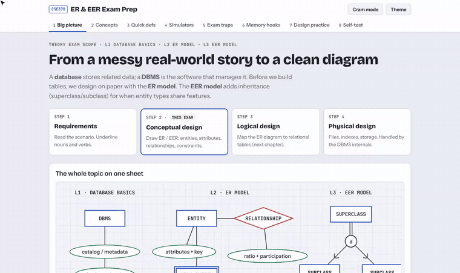
[▶ MP4 (20 s)](media/er-specialization-sim.mp4)

**3. Data independence simulator** (Simulators tab, Sim 3)
Click a change (add an index, add an attribute, add a view…) and the three-schema diagram shows which level changed in red. *Watch for:* each kind of independence protects the level just above the change.

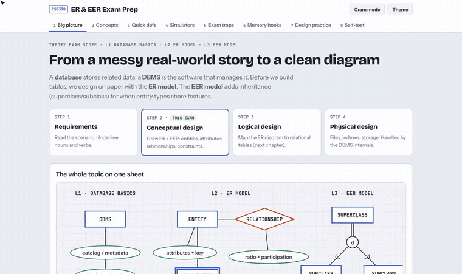
[▶ MP4 (16 s)](media/er-data-independence-sim.mp4)

**4. Design practice and self-test** (Design practice and Self-test tabs)
Attempt each practice-sheet scenario on paper, then press **Reveal step** to compare one step at a time. In the self-test, answer and get an explanation at once, or switch to flashcards and tap a card to flip it.

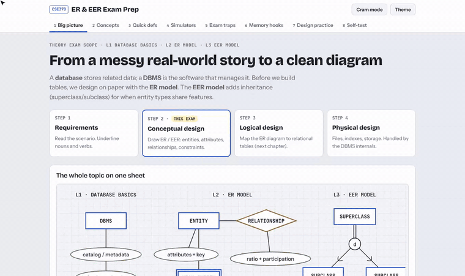
[▶ MP4 (30 s)](media/er-design-practice-self-test.mp4)

### Lectures 4–7 Exam Prep · [`lectures-4-7-exam-prep.html`](lectures-4-7-exam-prep.html)

**5. Constraint checker** (Simulators tab, 1)
Run INSERT, DELETE or UPDATE on a small Department/Student database. Use the **Try** buttons (Duplicate ID, NULL ID, Two at once…) or type your own values. The checker names every constraint broken (key, entity integrity, domain, referential integrity), says why, and how to prevent it. Deleting a referenced department shows RESTRICT vs CASCADE vs SET NULL.

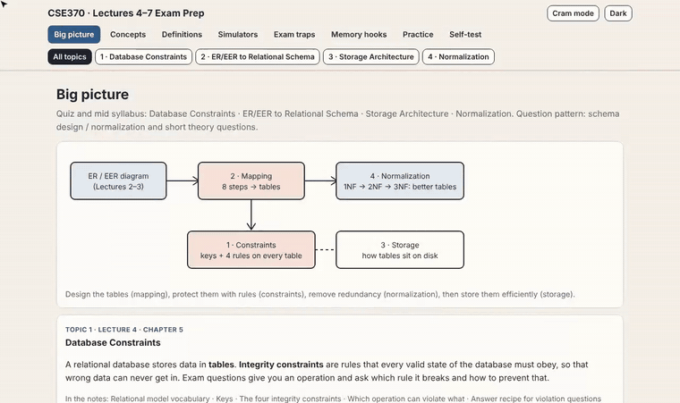
[▶ MP4 (29 s)](media/l47-constraint-checker.mp4)

**6. ER → schema mapper and Step 8 options** (Simulators tab, 2 and 3)
Pick a structure (weak entity, binary 1:N / N:M / 1:1, recursive, multivalued, n-ary), predict the tables, then read the mapped schema and the reasoning. For Step 8, set the circle (d/o) and the line (total/partial) from an EER diagram to see which of options 8A–8D apply, and why.

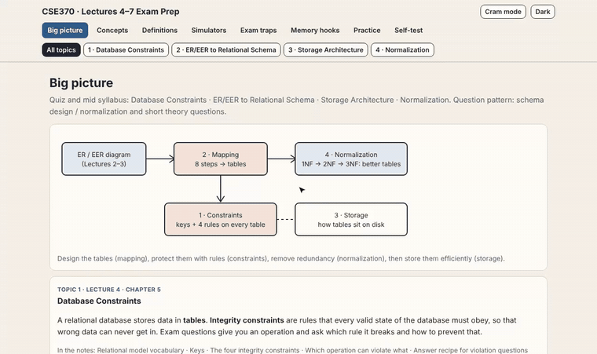
[▶ MP4 (26 s)](media/l47-schema-mapper.mp4)

**7. Normalization stepper** (Simulators tab, 4)
Choose a practice schema (Car_Sales, Books…), decide each check yourself, then press **Next check**. It shows the 1NF, 2NF and 3NF verdicts with the reason and the complete current schema after every step, which is exactly what the exam wants you to write.

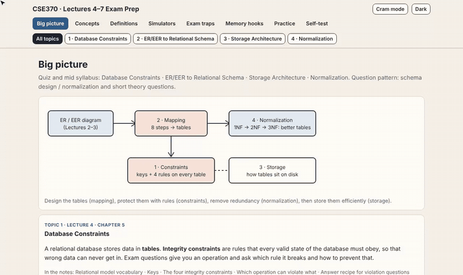
[▶ MP4 (20 s)](media/l47-normalization-stepper.mp4)

**8. Blocking factor calculator and heap / sorted / hash search** (Simulators tab, 5 and 6)
Change block size, record size and record count; the bfr, wasted bytes and blocks needed update live, with the working shown. Then search for a key and compare how many records a heap file, a sorted file (binary search) and a hash file check, including an overflow bucket and a key that isn't there.

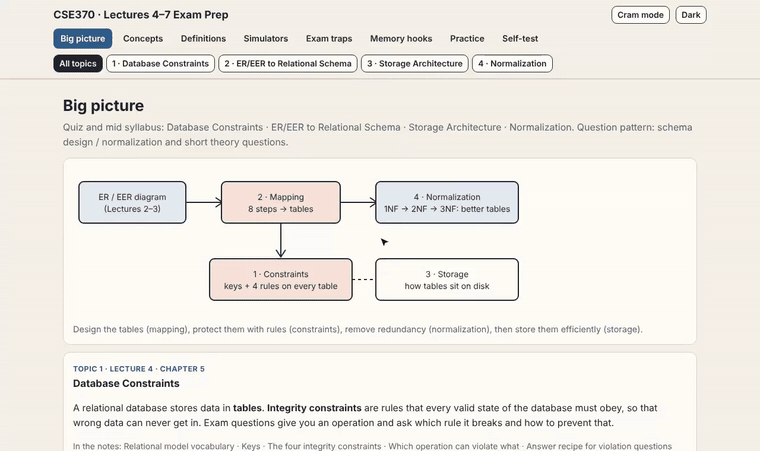
[▶ MP4 (28 s)](media/l47-storage-sims.mp4)

**9. Topic filters, practice, self-test and cram mode**
The topic chips under the tabs filter every tab to one lecture. Concepts open and close by clicking a heading. Practice questions hide their solutions until you ask. The self-test remembers wrong answers so **Retry my mistakes** drills only those. **Cram mode** strips the page down to the night-before essentials.

[▶ MP4 (24 s)](media/l47-filters-practice-self-test.mp4)

### Lab Exam Drill · [`lab-exam-drill.html`](lab-exam-drill.html)

**10. Mock paper with timer and score** (Practice tab)
Open the sample `players` table, start the 75-minute timer, write each query in the box (or on paper, since the real exam is written), then **Show answer** to see the query and its real MariaDB output. Mark yourself ✓ or ✗ and the counter at the top keeps score. Short on time? **Core questions only (★)** hides the rest.

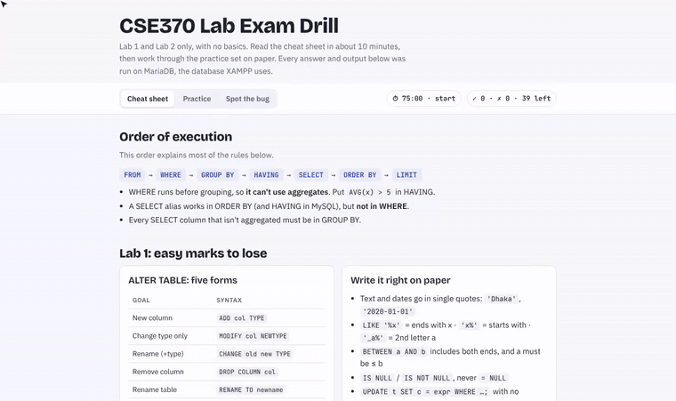
[▶ MP4 (29 s)](media/lab-practice.mp4)

**11. Spot the bug** (Spot the bug tab)
Ten short queries, each with the kind of mistake that loses marks (aggregates in WHERE, `=` with a multi-row subquery, `= NULL`…). Some are correct as written. Decide first, then reveal the fix and the explanation.

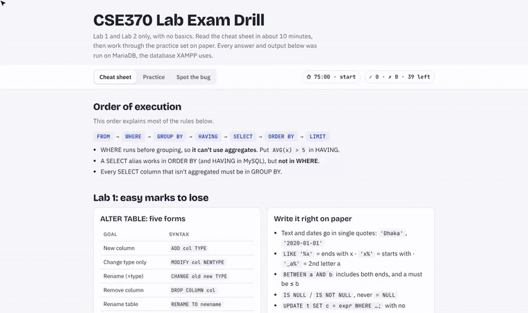
[▶ MP4 (18 s)](media/lab-spot-the-bug.mp4)

---

## How to use it

- **Easiest:** click **Code → Download ZIP** on the repo's main page, unzip, and open `CSE370/index.html` in any browser. Everything works offline (fonts load from Google when you're online, and the pages still work without them).
- **In the browser:** if GitHub Pages is turned on for this repo, open `https://raftan10.github.io/bracu-cse-visualized-resources_by_RAF/CSE370/`.
- **PDFs** open right here on GitHub. Click one in the table above.

Your quiz scores, marks and drafts are kept in your own browser only. Nothing is uploaded anywhere.

**Suggested order**
- *Theory exam on ER/EER:* ER & EER page, Big picture → Concepts → Simulators → Design practice (on paper first) → Self-test. Print the ER & EER PDF for the night before.
- *Quiz / mid on Lectures 4–7:* Lectures 4–7 page topic by topic: Concepts → that topic's simulator → Practice → Self-test, then **Retry my mistakes**. The night before, read only the definitions and exam traps (or turn on Cram mode).
- *Lab exam:* read the cheat sheet once (about 10 minutes), do the mock paper on paper with the timer running, then Spot the bug.

---

## Good to know

- **Built from the course itself:** the BRACU CSE370 lecture slides (Lectures 1–7 and the storage structure slides) and the Chapter 3, 4, 5, 7 and Lecture 7 practice sheets.
- **Lab answers were run, not just written.** Every query and output in the Lab Exam Drill was checked on MariaDB.
- **Ask your faculty when in doubt.** These are study aids, not official course material.

---

Made by RAF for juniors taking CSE370 at BRAC University. Built with Claude. Free to use and share; if it helped you, pass it on.
