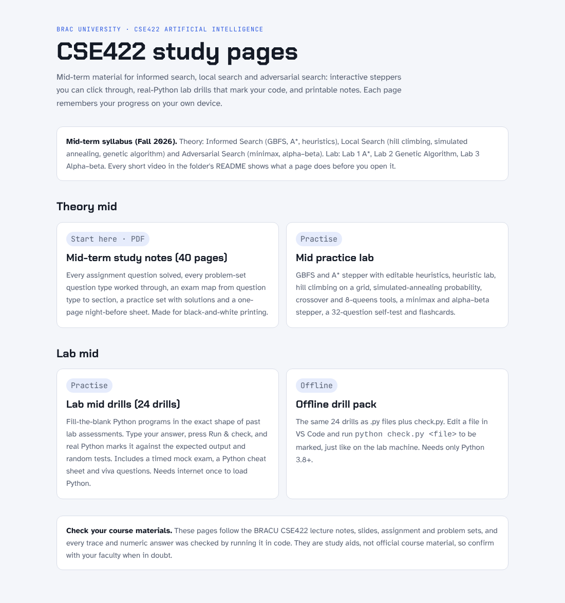
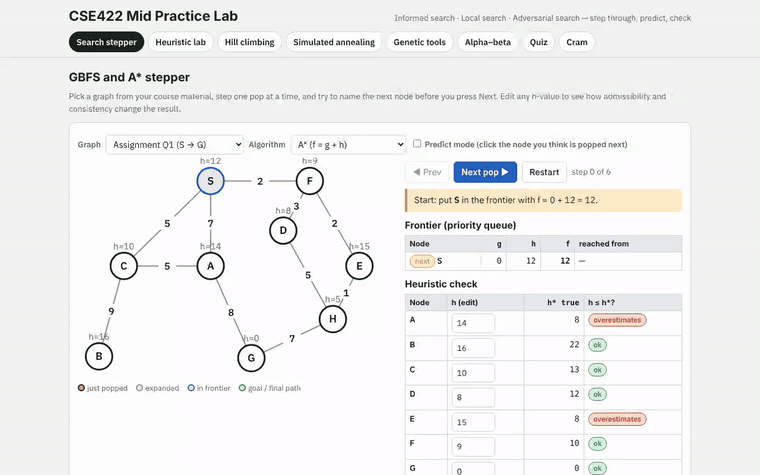
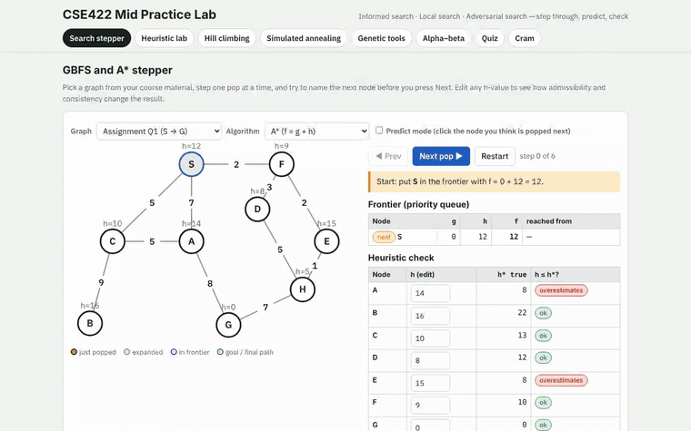
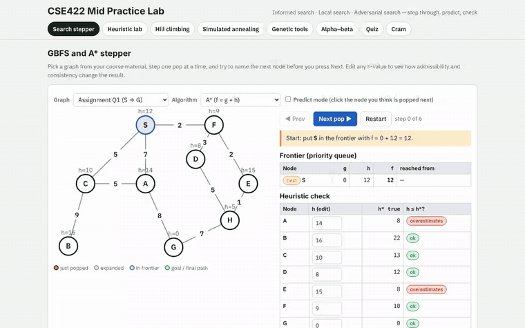
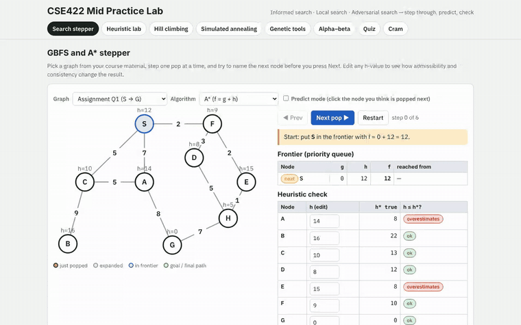
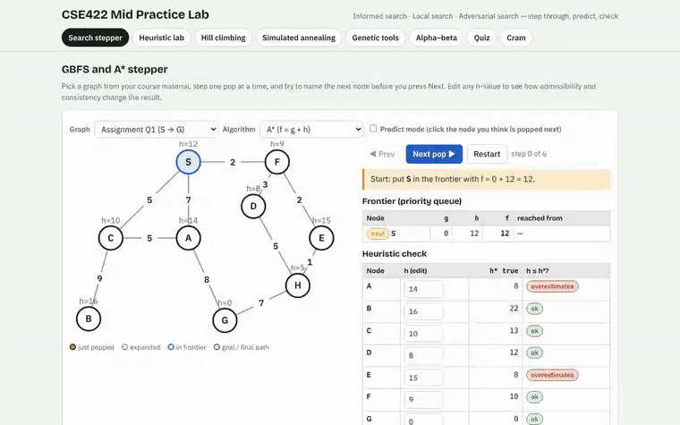
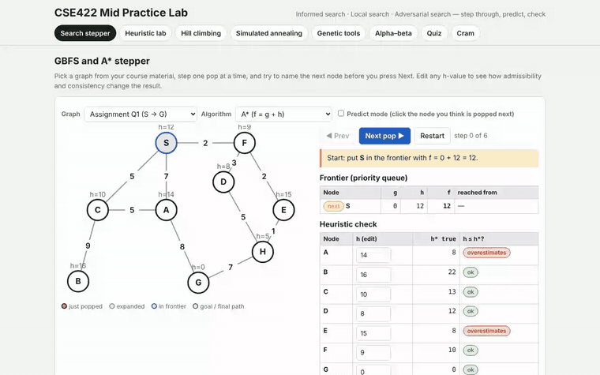
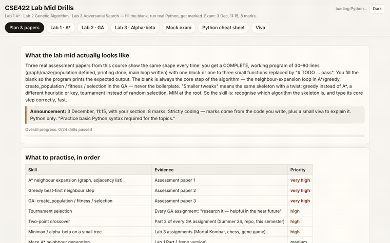
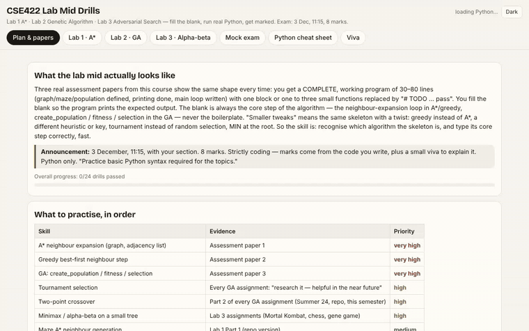

# CSE422 · Artificial Intelligence, visualized

**Mid-term study material for BRAC University's CSE422: click-through algorithm steppers, Python lab drills that mark your code, and printable notes. Built so you can *watch* A\*, hill climbing and alpha–beta work instead of memorizing traces.**

Step A\* one pop at a time and guess the next node. Drag the temperature and watch the simulated-annealing probability fall. Fill in the blank of a real past lab paper and get it marked by real Python. Every interactive part has a short video below, so you know what it does before you open it.



---

## Mid-term (Fall 2026)

| Exam | Syllabus | Start with |
|---|---|---|
| **Theory mid** | Informed Search (GBFS, A\*, heuristics) · Local Search (hill climbing, simulated annealing, genetic algorithm) · Adversarial Search (minimax, alpha–beta) | [Study notes PDF](pdf/CSE422_Mid_Notes.pdf) → [Mid practice lab](mid-theory-practice.html) |
| **Lab mid** | Lab 1 A\* search · Lab 2 Genetic Algorithm · Lab 3 Alpha–beta pruning | [Lab mid drills](lab-mid-drills.html) or the [offline drill pack](offline/) |

The theory mid follows the assignment's question types: simulate GBFS/A\*, check admissibility and consistency, build new heuristics from old ones, run hill climbing and name the trap, compute an annealing probability, do one GA iteration, and trace minimax with alpha–beta pruning. The lab mid gives a complete Python program with one to three blanks; you fill the core step of the algorithm so it prints the expected output, then explain it in a short viva.

---

## What's inside

| File | What it is |
|---|---|
| [`index.html`](index.html) | Start page linking everything below |
| [`pdf/CSE422_Mid_Notes.pdf`](pdf/CSE422_Mid_Notes.pdf) | 40-page printable notes for the theory mid |
| [`mid-theory-practice.html`](mid-theory-practice.html) | Mid practice lab: 8 interactive tabs for the theory mid |
| [`lab-mid-drills.html`](lab-mid-drills.html) | 24 fill-the-blank Python drills marked in your browser, plus a mock exam |
| [`offline/`](offline/) | The same 24 drills as `.py` files with a command-line checker |
| [`media/`](media/) | The demo videos and pictures on this page |

---

## 1 · Mid-term study notes (PDF)

[`pdf/CSE422_Mid_Notes.pdf`](pdf/CSE422_Mid_Notes.pdf) · 40 pages · built for black-and-white printing

Built from the IBU lecture notes (October 2025), the course slides, Assignment 01, PSET 1 Informed Search, the Heuristic Problem Set, the Fall-25 heuristic quiz solution, PSET 2 Local Search and PSET 3 Adversarial Search.

- **Exam map** on page 3: every question type from the assignment and problem sets, with the section where it is solved.
- **Chapter 1 · Informed Search:** vocabulary you must use in answers, heuristics, GBFS, A\*, admissibility, consistency, building heuristics from old ones (max, min, 2h …), dominance and effective branching factor, grid and ring problems, proof-type questions, short-answer bank.
- **Chapter 2 · Local Search:** how to "encode" a problem, hill climbing and its traps, simulated annealing, genetic algorithm.
- **Chapter 3 · Adversarial Search:** minimax, alpha–beta pruning, worked trees, PSET 3 Q1 and Q2.
- **Practice set with solutions**, then a **night-before sheet**: formulas on one page, fifteen traps that cost marks and a five-minute self-check.

Boxes are marked by type (definition, key rule, worked example, common mistake) so you can skim the right ones.

---

## 2 · Mid practice lab (theory)

[`mid-theory-practice.html`](mid-theory-practice.html) · 8 tabs along the top. Each one has a **What to notice** line telling you the one idea to take away.

### Search stepper: GBFS and A\*

Pick a graph from the course material (Assignment Q1 and others) and press **Next pop** to expand one node at a time. The frontier table shows g, h and f for every node, and the yellow box explains each decision in words. Switch the algorithm to **Greedy best-first** to see a different path, or edit any h-value to see admissibility (h ≤ h\*) and consistency change. Tick **Predict mode** to click the node you think comes next before the page shows you.


▶ [Full-quality video (MP4)](media/theory-search-stepper.mp4)

### Heuristic lab

Drag **dx** and **dy** and compare Manhattan, Euclidean, Octile and Chebyshev against the true cost. Switch between 4-direction and 8-direction moves to watch Manhattan go from "best" to "inadmissible". Below it, **Combining heuristics** (Assignment Q2 type) shows which of max, min, average, sum and 2·h stay admissible.



▶ [Full-quality video (MP4)](media/theory-heuristic-lab.mp4)

### Hill climbing on a grid

Click any cell to start there, then **Step** or **Run to the end**. On the Assignment Q6 treasure grid, a corner start gets stuck on a local maximum of 10 while another reaches 15. **Show which starts succeed** colours every start cell green or red, which gives you *p* and the expected number of random restarts (1/p).



▶ [Full-quality video (MP4)](media/theory-hill-climbing.mp4)

### Simulated annealing

Drag the temperature T and how much worse the move is (ΔE), and watch P = e^(−ΔE/T) update on a curve. **Draw a random number** shows whether the worse move is accepted. The **cooling schedule** table works PSET 2 style questions (T₀ = 100, α = 0.5, random numbers 0.2 and 0.5), and a drill gives you new questions to compute yourself.



▶ [Full-quality video (MP4)](media/theory-simulated-annealing.mp4)

### Genetic algorithm tools

The **crossover workbench** does order crossover (OX), single-point and two-point on any two parents, with every step written out; single-point on permutations shows repeated genes in red. The **8-queens fitness counter** lets you click squares to move queens and counts attacking pairs (fitness = 28 − attacking pairs). A step-by-step **knapsack GA drill** follows the course convention.



▶ [Full-quality video (MP4)](media/theory-genetic-tools.mp4)

### Minimax and alpha–beta stepper

Step through the lecture-notes tree (or your own leaf values) and watch α and β update node by node, with pruned branches marked. **Test me** hides the values until you answer. You can also switch the root to MIN.



▶ [Full-quality video (MP4)](media/theory-alpha-beta.mp4)

### Quiz and Cram

**Quiz** is a 32-question self-test across all three chapters. Each answer explains why it is right or wrong, and **Retry my mistakes** brings back only the ones you missed. **Cram** has 25 flashcards of definitions and formulas plus the fifteen traps that cost marks.



▶ [Full-quality video (MP4)](media/theory-quiz-and-cram.mp4)

---

## 3 · Lab mid drills

[`lab-mid-drills.html`](lab-mid-drills.html) · 24 drills across Lab 1 (A\*), Lab 2 (GA) and Lab 3 (alpha–beta)

Each drill is a complete lab-style program with the core step blanked out, exactly how the lab assessment gives it. The tag on each card tells you how likely it is:

- **REAL ASSESSMENT**: the actual blank from a past lab assessment paper of this course (A\* expansion, greedy best-first, GA create_population / fitness / selection).
- **ASSIGNMENT CORE**, **HIGH PROBABILITY**, **LIKELY BLANK**: the core steps from the lab assignments (maze A\*, admissibility checker, two-point crossover, mutation, minimax, alpha–beta, Mortal Kombat, Pacman).
- **TWEAK** and **HARD**: what an examiner can change (UCS instead of A\*, consistency checks, penalties in fitness, writing the whole function).

**How a drill works:** write your code in the answer box, press **Run & check** (or Ctrl + Enter), and real Python runs your program. It must print the expected output on the paper's input *and* behave like the reference on random inputs. **Hint** and **Show solution** are there when you are stuck, and your progress is saved in your browser.



▶ [Full-quality video (MP4)](media/lab-drill-run-and-check.mp4)

**Other tabs:**

- **Plan & papers:** what the lab mid looks like, what to practise in order, and the three real assessment papers with the parts they leave blank.
- **Mock exam:** a random blank from the labs you pick, 10 minutes on the clock, no hint or solution until you submit or time runs out.
- **Python cheat sheet:** the syntax you must type without thinking (heapq, dictionaries, random, slicing).
- **Viva:** questions to practise explaining your code.



▶ [Full-quality video (MP4)](media/lab-mock-exam.mp4)

> The page loads Python (Brython) from the internet the first time, so you need a connection once. The status at the top right says **Python ready** when it is loaded.

### Offline drill pack

[`offline/`](offline/) has every drill as a `.py` file plus `check.py`. This is closest to the real lab machine.

```bash
cd CSE422/offline
python check.py                          # list all drills and tick the ones you have passed
python check.py lab1_01_astar_expand.py  # mark your answer: PASS or FAIL with the reason
python check.py --hint lab1_01_astar_expand.py
python check.py --solution lab1_01_astar_expand.py
```

Open a drill in VS Code or IDLE, replace only the `# TODO` block, and run the checker. Needs Python 3.8+ and nothing else. Start with the REAL ASSESSMENT drills: `lab1_01`, `lab1_02`, `lab2_01` to `lab2_03`.

---

## How to use it

- **Easiest:** click **Code → Download ZIP**, unzip, and open `CSE422/index.html` in any browser. Every page works from your own computer; the lab drills page needs internet once to load Python.
- **The PDF** opens right here on GitHub: [CSE422_Mid_Notes.pdf](pdf/CSE422_Mid_Notes.pdf).
- **Videos:** the moving previews above play on this page; click **Full-quality video** under any of them for the sharp MP4.

Your quiz scores, passed drills and saved code are kept in your own browser only. Nothing is uploaded anywhere.

**Suggested order for the theory mid:** read the PDF's exam map → work each chapter of the PDF, then do the matching tab in the practice lab → the Quiz tab and Retry my mistakes → the PDF's practice set → the night-before sheet and the Cram tab.

**Suggested order for the lab mid:** Plan & papers → the five REAL ASSESSMENT drills until they pass without hints → the rest of Lab 1, 2 and 3 → two or three mock exams → the Viva tab.

---

## Good to know

- **Built from the course itself:** the IBU lecture notes, the slides, Assignment 01, PSETs 1–3, the Heuristic Problem Set, the Fall-25 quiz solution, and past lab assessment papers and assignments.
- **Every trace and numeric answer was checked** by running the algorithms in code, and every drill is marked by running Python, not by matching text.
- **Ask your faculty when in doubt.** These are study aids, not official course material.

---

<sub>Made by RAF for juniors taking CSE422 at BRAC University. Free to use and share; if it helped you, pass it on.</sub>
