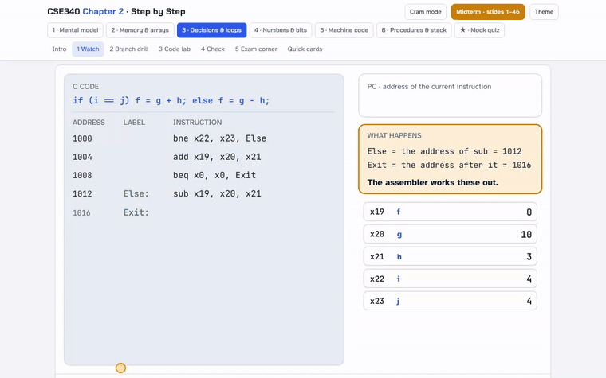
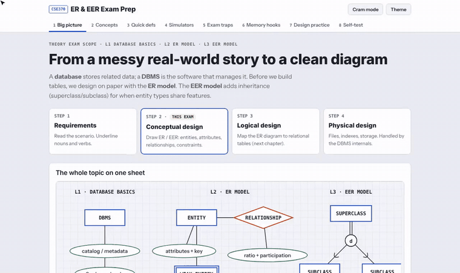

# BRACU CSE, visualized

**Interactive, visual study resources for BRAC University CSE courses: pages you can click, run and test yourself on, plus printable exam notes. Made by a student, for the juniors coming next.**

Most course notes are walls of text. These are built around one idea: if you can *see* it happen (a register change, a bit flip, a branch jump, an A\* node being popped), you understand it instead of memorizing it.

---

## Courses

| Course | What's there | Open |
|---|---|---|
| **CSE340** · Computer Architecture | 6 interactive pages and 3 printable exam-note PDFs covering Chapters 1–3 (RISC-V, IEEE 754), every Practice Sheet 1–3 question solved, midterm guides and self-tests | [`CSE340/`](CSE340/) |
| **CSE370** · Database Systems | 3 interactive pages with 9 simulators (ER/EER, constraints, schema mapping, storage, normalization), a SQL lab-exam mock paper with timer, 2 printable exam-note PDFs, and a short demo video for every interactive part | [`CSE370/`](CSE370/) |
| **CSE422** · Artificial Intelligence | Mid-term material: a 40-page printable notes PDF, an 8-tab practice lab (A\*, heuristics, hill climbing, simulated annealing, GA, alpha–beta, quiz) and 24 Python lab drills marked by real Python, with short demo videos of every interactive part | [`CSE422/`](CSE422/) |

More courses will be added folder by folder.

▶ [Watch the CSE422 demo in full quality (MP4)](CSE422/media/theory-search-stepper.mp4) · [more CSE422 videos](CSE422/)

▶ [Watch the CSE340 demo in full quality (MP4)](CSE340/media/cse340-tour.mp4) · [more CSE340](CSE340/)

---

## How to use

1. Click **Code → Download ZIP** and unzip it.
2. Open a course folder and double-click its `index.html`. It opens in your browser and works offline.
3. PDFs can be read right here on GitHub.

Each course folder has its own README with what's inside, the exam syllabus it targets and a suggested study order.

---

## Resources used to make the notes

Every page and PDF is built from the course's own material, then checked line by line:

- **Lecture slides** for every chapter and topic covered.
- **Faculty notes and handouts**, such as the PBK handouts for CSE340.
- **Practice sheets with the faculty's own solutions**, plus worksheets like the CSE340 Loop Examples sheet.
- **Textbooks** the courses follow, such as Patterson & Hennessy's *Computer Organization and Design, RISC-V Edition*, and their chapter-wise solutions.
- **Past questions, assignments, quizzes and lab resources** shared by the faculty.
- **Careful inspection:** every worked answer is checked by running it (in code, in a simulator, as SQL or as Python), not just written out. Typos found in the course material are pointed out with the fix.
- **Pro AI tools:** researched, written and cross-checked with Claude Fable 5.1 and Claude Opus 5.5.

Still a study aid, not official course material. When in doubt, ask your faculty.

---

By RAF ([@RafTan10](https://github.com/RafTan10)). Free to use and share.
